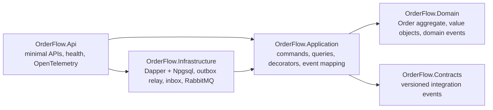
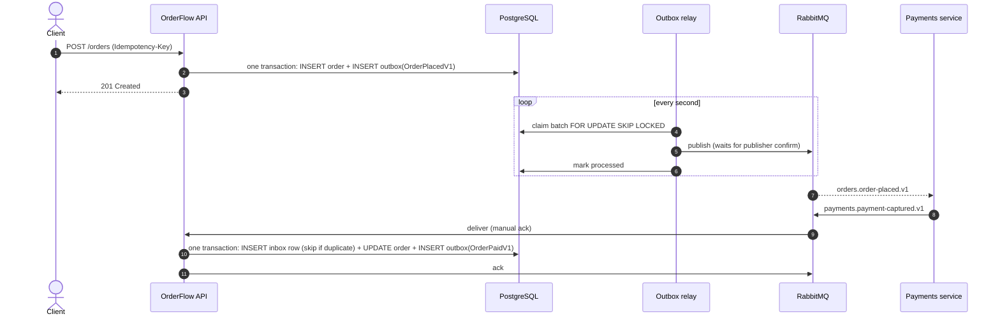

# OrderFlow

[](https://github.com/mengxie/orderflow/actions/workflows/ci.yml)


[](LICENSE)

**An event-driven order service on .NET 10 that changes state and publishes events reliably.**
It combines Clean Architecture, DDD and CQRS with the **transactional outbox** and an **idempotent inbox**,
over PostgreSQL and RabbitMQ, with W3C trace context carried through every message.

## The problem it solves

Placing an order means two writes to two systems: save the order, then tell other services
with an `OrderPlaced` event. Do them one after the other and a crash in between either loses the
event (payments never hears about the order) or announces an order that was never saved. Retries
make it worse: the broker redelivers, the client resubmits, and work happens twice.

OrderFlow handles each of these failure modes explicitly, and the integration tests prove it
against real PostgreSQL and RabbitMQ containers.

| Failure                                         | What happens here                                                                                             |
| ----------------------------------------------- | ------------------------------------------------------------------------------------------------------------- |
| Crash between saving an order and publishing    | The event is in the outbox, committed with the order; the relay publishes it after restart.                   |
| Broker down                                     | Events wait in the outbox with exponential backoff; `/health/ready` reports the lag.                          |
| Client retries `POST /orders` after a timeout   | Same `Idempotency-Key`, same order: `200` with the original instead of a duplicate.                           |
| RabbitMQ redelivers a payment message           | The inbox row already exists, so the message is acknowledged and skipped.                                     |
| A message keeps failing (poison message)        | The quorum queue's delivery limit moves it to the dead-letter queue.                                          |
| Two requests change the same order concurrently | The order's version check rejects the second with `409 Conflict`.                                             |
| Several instances relay the outbox at once      | `FOR UPDATE SKIP LOCKED` gives each relay a different batch.                                                  |

## Architecture



Dependencies point inwards. The domain and the public contracts depend on nothing but the base
class library, and that rule is enforced by tests, not by convention (see
[ArchitectureTests](tests/OrderFlow.ArchitectureTests/ArchitectureTests.cs)).

### How an order flows



The details, including every failure mode and the exact SQL behind each guarantee, are in
[docs/architecture.md](docs/architecture.md).

## Highlights

- **Rich domain model.** `Order` enforces every invariant (line limits, duplicate SKUs, currency
  consistency, legal state transitions) and raises exactly one domain event per change.
  Expected failures are `Result` values with stable error codes; exceptions are reserved for bugs.
- **CQRS without a mediator library.** Handlers are plain classes injected directly, with
  instrumentation and transactions added by explicit decorators at registration.
- **Anti-corruption boundary.** Internal domain events are mapped to public, versioned contracts
  (`OrderPlacedV1`), so the model can be refactored without breaking consumers.
- **Hand-written SQL.** Dapper over a pooled `NpgsqlDataSource`, with embedded, versioned
  migrations applied under a PostgreSQL advisory lock so concurrent startups are safe.
- **Observability built on the BCL.** `ActivitySource` and `Meter` in the application and
  infrastructure layers, wired to OpenTelemetry only in the host. Trace context travels from the
  HTTP request through the outbox table and RabbitMQ headers to the consumer.
- **Production hygiene.** Liveness and readiness probes, outbox-lag health check, RFC 9457
  problem details, source-generated logging, a chiseled non-root container image.

## Run it

You need Docker. The whole stack (PostgreSQL, RabbitMQ, the Aspire dashboard and the API) starts
with one command:

```bash
docker compose up --build
```

| What                  | Where                                                    |
| --------------------- | -------------------------------------------------------- |
| API                   | http://localhost:8080                                    |
| OpenAPI document      | http://localhost:8080/openapi/v1.json                    |
| Traces, metrics, logs | http://localhost:18888 (Aspire dashboard)                |
| RabbitMQ management   | http://localhost:15672 (`orderflow` / `orderflow`)       |

Then work through [`OrderFlow.Api.http`](src/OrderFlow.Api/OrderFlow.Api.http) in Visual Studio,
Rider or VS Code: place an order, retry it, simulate the payments service, and ship it. Or with curl:

```bash
curl -i -X POST http://localhost:8080/orders \
  -H "Content-Type: application/json" -H "Idempotency-Key: demo-1" \
  -d '{"customerId":"0193a5b2-7c41-7d2e-9f10-3c5e8a1b2d4f","currency":"NZD",
       "lines":[{"sku":"KEYBOARD","quantity":2,"unitPrice":89.50}]}'
```

To run the API from your IDE instead, start only the dependencies with
`docker compose up postgres rabbitmq dashboard` and run `src/OrderFlow.Api`.

## API

| Method & path                  | Purpose                                                              |
| ------------------------------ | -------------------------------------------------------------------- |
| `POST /orders`                 | Place an order. Requires `Idempotency-Key`. `201` new, `200` replay. |
| `GET /orders/{id}`             | Read an order (served by the read side, without loading the aggregate). |
| `POST /orders/{id}/cancel`     | Cancel; a paid order announces that a refund is required.            |
| `POST /orders/{id}/ship`       | Ship a paid order.                                                   |
| `POST /dev/payments`           | Development only: publish `PaymentCapturedV1` as the payments service would. |
| `GET /health/live`, `/health/ready` | Liveness; readiness covers PostgreSQL, RabbitMQ and outbox lag. |

Errors are [RFC 9457](https://www.rfc-editor.org/rfc/rfc9457) problem details with a stable `code`
such as `order.invalid_transition` or `sku.invalid`.

### Messages

| Direction | Routing key                        | Exchange           |
| --------- | ---------------------------------- | ------------------ |
| Published | `orders.order-placed.v1`           | `orderflow.events` |
| Published | `orders.order-paid.v1`             | `orderflow.events` |
| Published | `orders.order-shipped.v1`          | `orderflow.events` |
| Published | `orders.order-cancelled.v1`        | `orderflow.events` |
| Consumed  | `payments.payment-captured.v1`     | `payments.events` → quorum queue `orderflow.payments` |

Every message carries a stable `MessageId` for deduplication, and each order event carries
`OrderVersion` so consumers can order and discard stale updates.

## Tests

```bash
dotnet test   # Docker must be running for the integration tests
```

| Suite              | What it covers                                                                                  |
| ------------------ | ----------------------------------------------------------------------------------------------- |
| Domain (43)        | Invariants, state transitions, idempotent payment, money and SKU rules.                          |
| Application (22)   | Handlers against in-memory fakes, decorator behaviour, DI composition, event mapping.           |
| Architecture (7)   | Layer dependency rules, immutable domain, sealed handlers, read from compiled assemblies.        |
| Integration (11)   | The real app with real PostgreSQL and RabbitMQ (Testcontainers): idempotent API, outbox publishing, duplicate deliveries applied exactly once. |

## Project structure

```
src/
  OrderFlow.Domain/          Aggregate, value objects, domain events, Result/Error. No dependencies.
  OrderFlow.Contracts/       Versioned integration events, shareable with other services.
  OrderFlow.Application/     Commands, queries, consumers, decorators, domain → contract mapping.
  OrderFlow.Infrastructure/  Persistence (Dapper, SQL migrations), outbox relay, inbox, RabbitMQ, health checks.
  OrderFlow.Api/             Minimal API endpoints, problem details, OpenTelemetry, composition root.
tests/                       Domain, Application, Architecture and Integration test projects.
docs/                        Architecture guide and Architecture Decision Records.
```

Engineering setup: `.slnx` solution, Central Package Management, nullable reference types,
the recommended .NET analyzer set and code style enforced as build errors, and CI that runs
every test suite and builds the container image.

## Design decisions

1. [Clean Architecture with a dependency-free domain, enforced by tests](docs/adr/0001-clean-architecture.md)
2. [Transactional outbox instead of dual writes](docs/adr/0002-transactional-outbox.md)
3. [Idempotent inbox for at-least-once delivery](docs/adr/0003-idempotent-inbox.md)
4. [No mediator library: handlers and decorators](docs/adr/0004-no-mediator.md)
5. [Dapper and SQL migrations instead of EF Core](docs/adr/0005-dapper-and-sql-migrations.md)
6. [Result values for expected failures](docs/adr/0006-result-values.md)

## Limitations and next steps

- Events are published at least once and not in strict global order; consumers deduplicate on
  `MessageId` and order by `OrderVersion`. Strict per-order ordering would need partitioned relays.
- No authentication yet; the next step is JWT bearer auth with per-customer authorisation.
- Retries for inbound messages rely on the quorum queue's delivery limit; delayed retry queues
  would reduce pressure on a struggling dependency.
- A `PaymentRefunded` flow for cancelled paid orders would complete the saga with the payments service.

## License

[MIT](LICENSE) © Meng Xie
